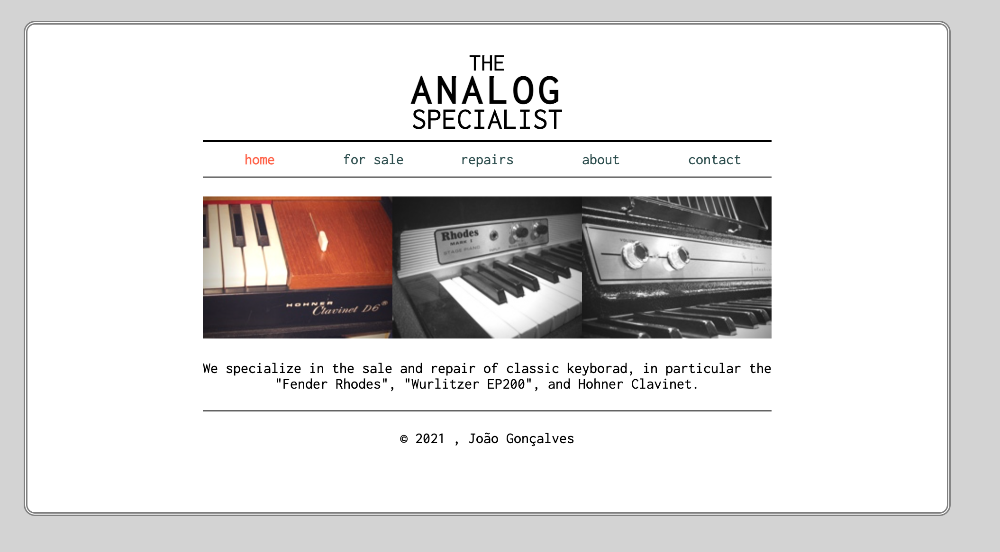
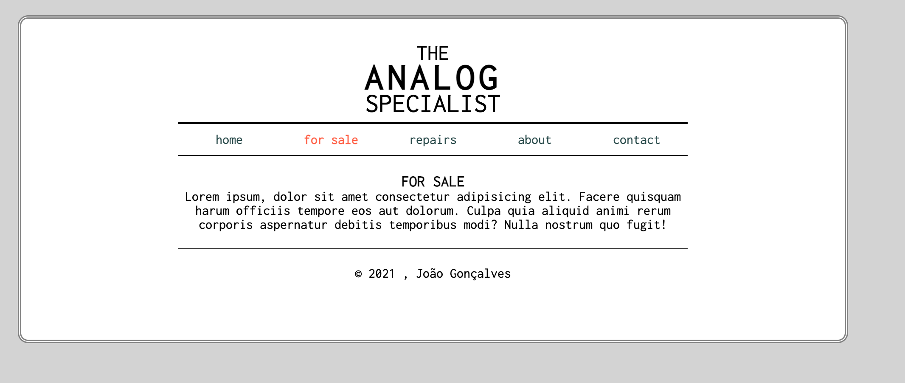

# Exercício 14.1 · The Analog Specialist

> Parte 14 · O box model · sessão 9 · **sozinhos** (~60 min; o que faltar, em casa)

Um site de duas páginas, **do zero**, para uma loja de teclados clássicos. HTML e CSS vossos: não copiem do site das receitas.

**Nesta pasta:** `img/` (as três imagens, 200×150px) e `proposta/` (`index.png` e `forsale.png`: o que o site deve parecer).
Copiem a pasta para **`s09/analog/`** e criem lá o `index.html`, o `forsale.html` e o `css/estilos.css`.

## Os requisitos

1. **O mais parecido possível com as propostas.** O título ("THE ANALOG SPECIALIST") é texto, não imagem.
2. **A caixa exterior** ocupa **80%** da largura da janela, **nunca menos de 800px**, e fica centrada.
3. Essa caixa tem **border `double`** e os **cantos arredondados**.
4. **Uma fonte do Google Fonts** à vossa escolha (a da proposta é a *Inconsolata*).
5. **Os links têm estados** (pelo menos `:hover`) e **a página atual** aparece destacada no menu.
6. **"for sale"** abre a `forsale.html`, com **título, subtítulo e texto** à vossa escolha. No texto da página inicial, a palavra **"Fender"** é um link para o site da marca (fender.com), num novo separador.
7. **`rem`** no tamanho do texto e nos espaços, **CSS num ficheiro externo**, e **HTML e CSS validados** (validator.w3.org e jigsaw.w3.org/css-validator).

O texto da página inicial:

> We specialize in the sale and repair of classic keyboards, in particular the "Fender Rhodes", "Wurlitzer EP200", and Hohner Clavinet.

**Pronto quando:** as duas páginas parecem as propostas e o menu leva de uma à outra (e volta).

## Como começar

Primeiro o HTML das duas páginas (com `header`, `nav`, `main` e `footer`). Depois o CSS, **de fora para dentro**: o mini reset, o `body`, a caixa, o título, o menu, as imagens, o texto e o rodapé. Vão vendo no DevTools (Computed) o desenho de cada caixa.

Presos? Primeiro o MDN, os snippets das sessões 7, 8 e 9 e o DevTools. Mais de 10 minutos parados: mão no ar no Teams.

## Extra (para treinar)

As imagens a preto e branco, que ganham cor quando o rato passa por cima. Descubram a propriedade `filter` no MDN.

