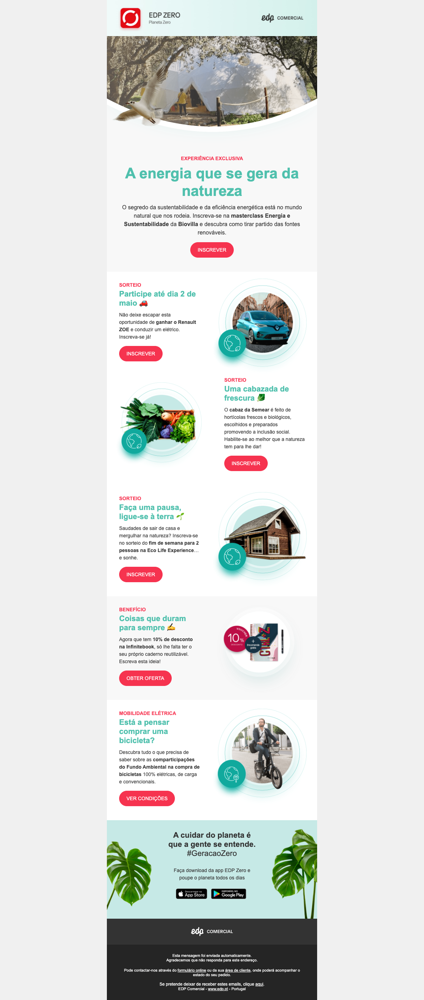

# Exercício 17.3 · A newsletter EDP Zero com flexbox

> Parte 17 · Flexbox · sessão 10 · **sozinhos** (começa na aula, ~50 min; acaba no fim de semana). Solução no início da sessão 11.

Uma newsletter a sério, feita do zero com HTML e CSS, com o **flexbox** a fazer o layout. É uma newsletter real da EDP (2021), usada aqui só como exercício de treino.

**Nesta pasta:** `_edp-proposta.png` (o que deve parecer), `images/` (as imagens e a fonte) e `copy.txt` (os textos todos e as cores, para não perderem tempo a escrever). Copiem a pasta para **`s10/edp/`** e criem lá o `index.html` e o `css/estilos.css`.

## Os requisitos

1. **Uma coluna central** com cerca de 600px de largura máxima, centrada na página (como as newsletters).
2. **O topo:** o logótipo EDP Zero (imagem e texto) à esquerda e "edp comercial" à direita, alinhados ao centro na vertical. Por baixo, a fotografia grande.
3. **O destaque:** etiqueta, título, texto e o botão, tudo centrado.
4. **Os cinco blocos de texto e imagem:** o texto e a imagem lado a lado, com o texto ao centro na vertical. **O bloco 2 tem a imagem do outro lado:** façam-no só com CSS (sem mudar a ordem no HTML). O bloco 4 tem um fundo cinzento claro.
5. **Os botões** vermelhos e redondos (`border-radius`), como links (`<a>`).
6. **A app:** os textos centrados e os dois botões das lojas lado a lado, centrados. As folhas dos lados são **extra**.
7. **Os rodapés:** o primeiro com "edp comercial" centrado; o segundo com o texto pequeno e centrado.
8. **HTML semântico** (`header`, `main`, `section`/`article`, `footer`), **CSS num ficheiro externo**, `rem` no texto e nos espaços, e **HTML e CSS validados**.

**Pronto quando:** a página parece a proposta, os blocos alternam de lado e nada usa `float` nem `position`: o layout é todo flexbox.

## A ordem que recomendo

1. **O HTML todo primeiro**, sem CSS, com os textos do `copy.txt`. Um bloco de texto e imagem é sempre igual: copiem-no cinco vezes.
2. A coluna central (`max-width` e `margin` auto, da sessão 9).
3. O topo (`display: flex`, `justify-content`, `align-items`).
4. **Um** bloco de texto e imagem até ficar bem. Depois os outros saem quase de graça; o bloco 2 com `flex-direction: row-reverse` (ou `order`).
5. A app e os rodapés.
6. As cores, as fontes e os botões no fim.

**Presos?** Os exemplos `s10/exemplos/17-flexbox/` (`flex1` a `flex9`), os snippets da sessão 10 e o DevTools (a etiqueta **flex** ao lado de cada contentor). Mais de 10 minutos parados: mão no ar no Teams.

## Extra (para treinar)

- **A fonte da marca:** `images/Patron-Regular.woff` com `@font-face` (sessão 8) nos títulos.
- **As folhas** dos lados da secção da app (`folha1.png` e `folhadrt.png`), uma em cada ponta (flexbox, com o texto ao meio).
- **A onda** por baixo da fotografia e os **anéis** à volta das imagens redondas: tentem com `border-radius` e `box-shadow`.
- **Os emojis** dos títulos (🚗 🥬 🌱 ✍️) são texto: copiem-nos da proposta ou do teclado de emojis.
