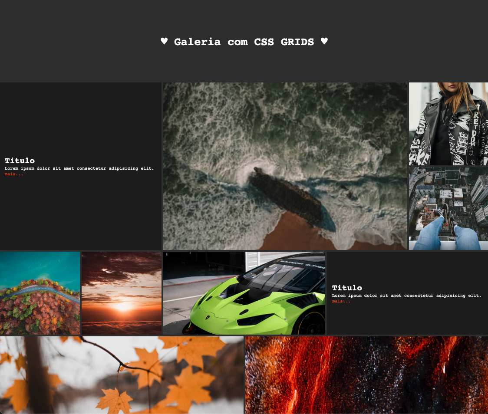

# Exercício 18.1 · A galeria com CSS Grid

> Parte 18 · Grid · sessão 11 · **sozinhos** (~40 min). Na sessão 12 tornamo-la responsiva (media queries).

Uma galeria de fotografias em grelha, como a proposta. **O HTML e o aspeto já estão feitos:** só falta a grelha.

**Nesta pasta:** `gallery.html` (o HTML, com as classes já postas), `css/estilos.css` (o aspeto, com um bloco vazio no fim para a grelha) e `proposta.png`. As fotografias vêm de picsum.photos: é preciso estar online.

## Os requisitos

1. **O `main` é a grelha:** 6 colunas iguais, linhas de `20vh` e `5px` de espaço entre as peças.
2. **As peças maiores**, pelas classes que já estão no HTML (`c` = colunas, `r` = linhas):
   - `c2xr1`: 2 colunas · `c2xr2`: 2 colunas e 2 linhas
   - `c3xr1`: 3 colunas · `c3xr2`: 3 colunas e 2 linhas
   - sem classe: 1 coluna e 1 linha
3. **Comparem com a proposta:** as peças encaixam sem buracos.
4. **Validem o CSS.**

**Pronto quando:** a galeria parece a proposta.

**Presos?** Os exemplos `s11/exemplos/18-grid/` (o 4, com `span`, e o 7, com `grid-auto-rows`) e o DevTools: o Chrome mostra uma etiqueta **grid** ao lado do contentor. Cliquem: desenha as linhas e os números.

## Para pensar

As imagens enchem a célula sem se deformarem por causa do `object-fit: cover` (já está no CSS): é o `background-size: cover` das imagens ``.

## Extra (para treinar)

- Um zoom suave nas fotografias quando o rato passa por cima (`transition` e `transform: scale()`), sem sair da célula.
- Experimentem trocar as classes no HTML: a grelha arruma-se sozinha.
