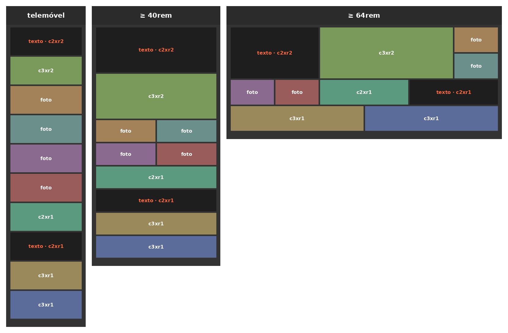

# Exercício 19.1 · A galeria responsiva

> Parte 19 · Responsive · sessão 12 · **sozinhos** (~35 min). Parte da galeria do 18.1, já com a grelha (fizemo-la juntos no início da sessão).

A mesma galeria, agora **mobile-first**: uma coluna no telemóvel, duas no tablet e a grelha do 18.1 no ecrã grande.

**Onde:** na vossa `s12/galeria/`, no fim do `css/estilos.css` (o bloco "19.1"). A grelha do 18.1 já lá está: vão ter de a **mudar de sítio**.

## Os requisitos

1. **Telemóvel, a base (sem media query):** o `main` é uma grelha de **1 coluna**, com linhas de `15rem` e `5px` de espaço. As classes `c2xr1`, `c3xr2`… **ainda não fazem nada**.
2. **A partir de `40rem` (640px):** **2 colunas** iguais e linhas de `12rem`. Todas as peças com classe ocupam **as 2 colunas**; as que têm `r2` ocupam também **2 linhas**.
3. **A partir de `64rem` (1024px):** a grelha do 18.1: **6 colunas**, linhas de `20vh`, e as `c3…` ocupam **3 colunas**.
4. **Testem** no DevTools, no modo dispositivo (Ctrl/Cmd+Shift+M): em nenhum tamanho aparece uma barra de scroll na horizontal.
5. **Validem o CSS.**

**Pronto quando:** ao alargar a janela devagar, a galeria passa pelas três formas da proposta, sem buracos.

**Presos?**

- Se no telemóvel aparece scroll para o lado, há um `span` fora de uma media query: com uma coluna só, um `span 2` cria uma coluna a mais.
- Mobile-first: as media queries com `min-width` vêm **por ordem crescente** (primeiro a de `40rem`, depois a de `64rem`). Cada uma só acrescenta o que muda.
- Os exemplos da sessão: `s12/exemplos/19-responsive/` (o 1, com os dois breakpoints, e o 3, com o grid).

## Extra (para treinar)

O título encolhe no telemóvel sem media query nenhuma: `font-size: clamp(1.1rem, 4vw, 2rem)`. Experimentem e expliquem por palavras vossas o que fazem os três valores.
